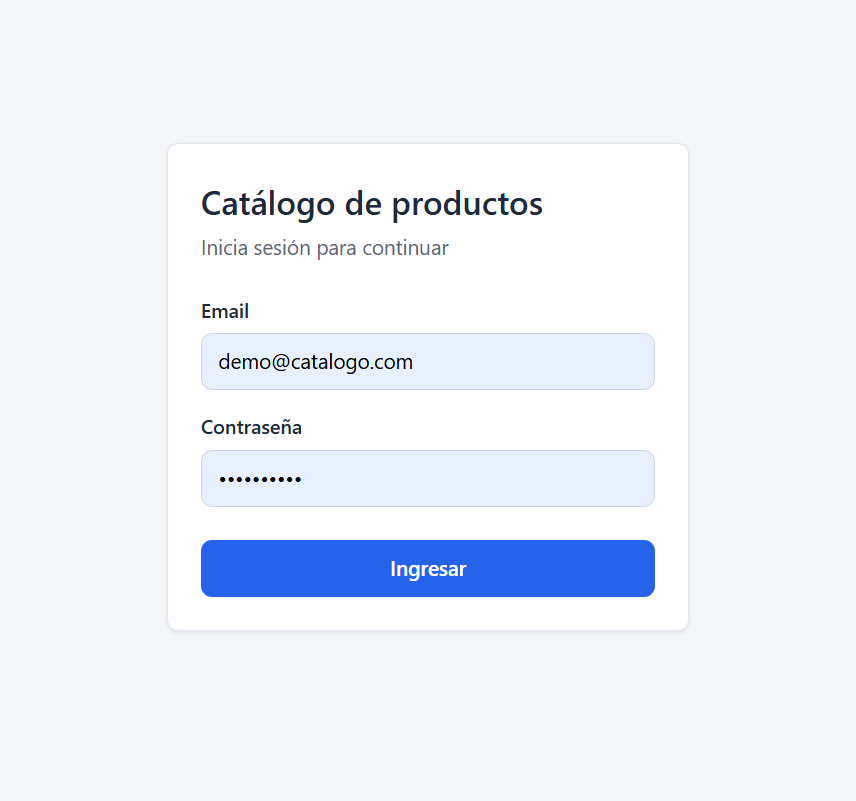
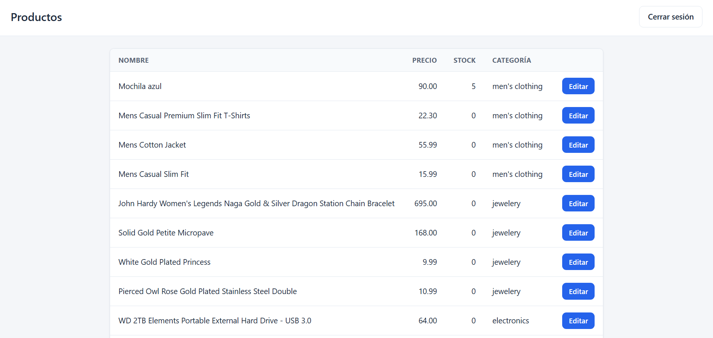
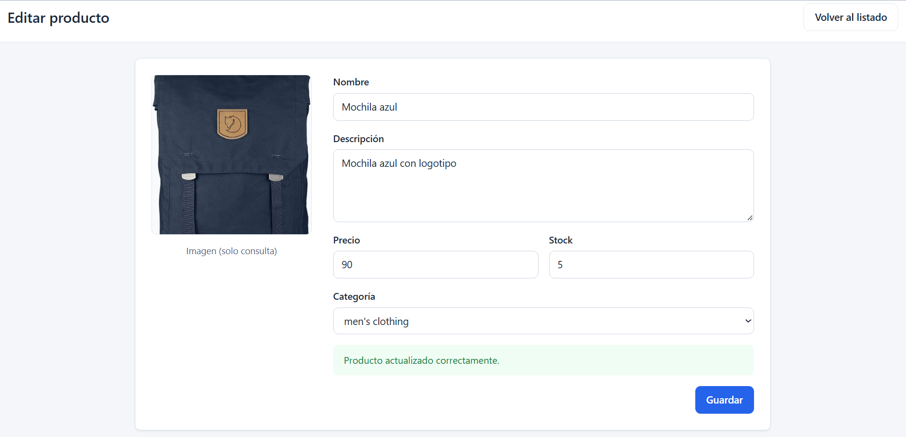
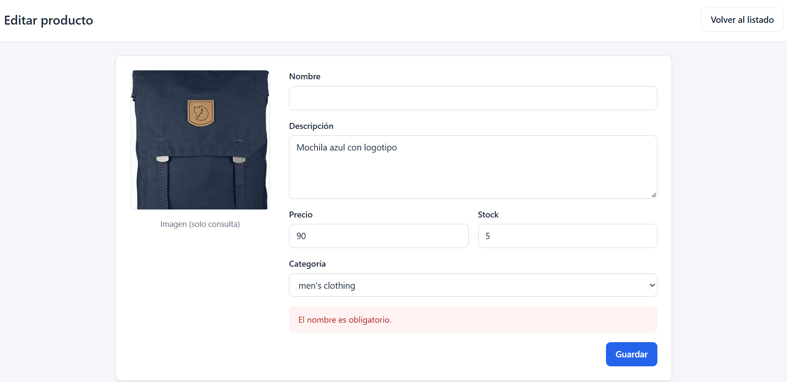

# Catálogo de productos - Desafío técnico Full Stack

Aplicación web para iniciar sesión, importar el catálogo de Fake Store API a una base local y editar productos.

## Stack

| Componente | Tecnología |
|---|---|
| Frontend | Angular + TypeScript |
| Backend | ASP.NET Core Web API (C#) + Entity Framework Core |
| Base de datos | SQL Server 2022 (Docker) |
| Autenticación | JWT + hashing de contraseñas con BCrypt |
| Contenedores | Docker + Docker Compose |

## Requisitos y versiones

- Docker Desktop 28.1.1
- Para ejecución local (opcional): .NET SDK 9, Node.js 22, Angular CLI 21.2.19

## Ejecución con Docker (recomendada)

Desde la raíz del repositorio:

```powershell
copy .env.example .env
docker compose up --build
```
Cuando el log del backend muestre `Productos importados con éxito: 20`, abrir http://localhost:4200.

Para empezar desde cero (borra la base): `docker compose down -v`.

## Configuración

Las variables están en `.env.example` (valores de demostración, sin secretos reales):

| Variable | Uso |
|---|---|
| `SA_PASSWORD` | Contraseña del usuario `sa` de SQL Server |
| `JWT_KEY` | Clave para firmar los tokens (mínimo 32 caracteres) |
| `SEED_EMAIL` / `SEED_PASSWORD` | Credenciales del usuario de demostración |

## Usuario de demostración

Se crea automáticamente al iniciar el backend (seeder), si no existe. Con los valores por defecto:

- **Email:** `demo@catalogo.com`
- **Contraseña:** `Demo12345!`

La contraseña se guarda con hash BCrypt.

## Importación del catálogo

Se ejecuta automáticamente al iniciar el backend, después de aplicar las migraciones y crear el usuario.

- Consulta primero categorías y productos; recién después guarda.
- Omite los productos cuyo `ExternalId` ya existe, reutiliza categorías y no sobrescribe ediciones locales. Además, `ExternalId` tiene un índice único en la base.
- El resultado (importados y omitidos) se muestra en el log del backend. Ejemplo:
  `Productos importados con éxito: 20. Productos omitidos (duplicados/existentes): 0.`
- Si la API externa falla, el error se registra en el log y el backend sigue funcionando. Para reintentar: `docker compose restart backend`. No duplica registros.

## API

Todas las rutas, salvo el login, requieren `Authorization: Bearer <token>`.

| Método | Ruta | Uso |
|---|---|---|
| POST | `/api/auth/login` | Iniciar sesión |
| GET | `/api/products` | Listar productos locales |
| GET | `/api/products/{id}` | Obtener un producto |
| PUT | `/api/products/{id}` | Guardar cambios locales |
| GET | `/api/categories` | Cargar el selector de categorías |

El `PUT` valida en el backend: nombre obligatorio (sin espacios), precio ≥ 0, stock entero ≥ 0 y categoría existente.

## Ejecución en local (opcional)

1. Levantar SQL Server (por ejemplo, con Docker) y guardar los secretos en `backend`:
```powershell
   dotnet user-secrets set "ConnectionStrings:DefaultConnection" "Server=localhost,1433;Database=Catalogo;User Id=sa;Password=<tu-clave>;TrustServerCertificate=True"
   dotnet user-secrets set "Jwt:Key" "<clave-de-32-caracteres-o-mas>"
   dotnet user-secrets set "Seed:Email" "demo@catalogo.com"
   dotnet user-secrets set "Seed:Password" "Demo12345!"
```
2. Backend: `dotnet run` (puerto 5163).
3. Frontend: `npm install` y `ng serve` (http://localhost:4200). El proxy de desarrollo (`proxy.conf.json`) reenvía `/api` al backend.

## Decisiones técnicas

- **SQL Server en lugar de MySQL:** es la opción más alineada con el stack .NET.
- **JWT sin revocación:** al cerrar sesión se elimina el token del cliente, pero sigue siendo válido hasta que expire (2 horas).
- **Importación al iniciar en lugar de botón:** Se importa al iniciar para que el sistema quede listo con un solo comando, sin pasos manuales. Además, reiniciar no duplica datos ni sobrescribe ediciones. 
- **DTO separados de las entidades:** controlan qué datos entran y salen de la API y evitan ciclos en la serialización. `ExternalId` no existe en el DTO de edición, por lo que no puede modificarse.
- **Clave propia (`Id`) además de `ExternalId`:** la base no depende de los identificadores de un sistema externo.
- **Proxy en lugar de CORS:** el frontend llama a rutas relativas `/api/...`; el proxy de `ng serve` (en local) y nginx (en Docker) las reenvían al backend.
- **Usuario `sa`:** se usa por simplicidad en este entorno de demostración; en producción se usaría un usuario con permisos limitados.

## Herramientas de IA utilizadas

- **Claude (Anthropic):** orientación paso a paso y revisión conceptual del backend (modelo, migraciones, autenticación, importación). El código del backend fue escrito por mí.
- **Claude Code:** generó el código del frontend en Angular a partir de un prompt con el contrato de la API. Revisé y probé el resultado.

## Capturas





